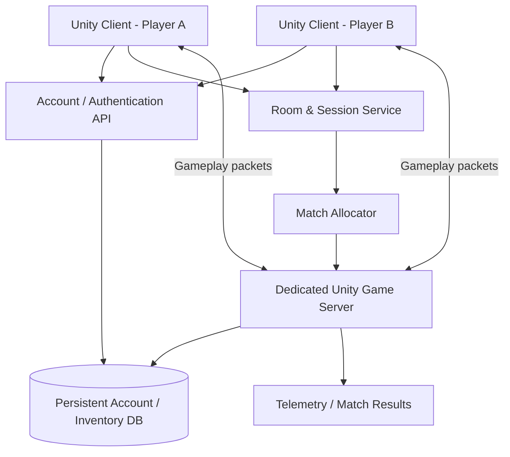

# GDD — Ghost Survival (Working Title)

> **Trạng thái:** Concept / Pre-production  
> **Engine:** Unity 2D  
> **Thể loại:** Cute atmospheric survival / exploration / co-op  
> **Góc nhìn:** Top-down, di chuyển 4 hướng  
> **Quy mô co-op mục tiêu:** 1–4 người / expedition  
> **Nguyên tắc:** Gameplay dễ hiểu, thế giới có chiều sâu; cute ở nhân vật, ma mị ở môi trường.

---

## 1. High concept

Người chơi là một linh hồn nhỏ màu đen, thân hình mềm và bo tròn, có đôi mắt trắng lớn. Linh hồn sống trong một thế giới lạ gần như đơn sắc, nơi sương mù, rừng cây, đầm lầy và những sinh vật khác luôn ẩn chứa rủi ro.

Để tồn tại, người chơi phải hấp thụ các hạt linh hồn, tìm trái cây và tài nguyên, quản lý thể lực, khám phá bản đồ, tránh hoặc đối đầu với sinh vật săn mồi. Có thể chơi một mình hoặc lập phòng rủ bạn bè cùng thám hiểm.

**Fantasy cốt lõi:** Mình là một linh hồn nhỏ bé, đáng yêu trong một thế giới rộng lớn, đẹp kỳ lạ nhưng không hoàn toàn an toàn.

### 1.1 Design pillars

1. **Cute silhouette, eerie world:** nhân vật và pet đáng yêu; môi trường, âm thanh, sương mù và hành vi quái tạo cảm giác bất an.
2. **Easy to learn, hard to master:** ít chỉ số, điều khiển đơn giản, nguy hiểm được báo hiệu bằng hình ảnh/âm thanh thay vì tutorial dài.
3. **Risk versus reward:** đi càng sâu hoặc ở lại càng lâu thì càng có cơ hội tìm thấy tài nguyên hiếm, nhưng rủi ro tăng lên.
4. **A meaningful co-op story:** người chơi có thể cứu nhau, chia vai trò, lạc nhau, cùng quyết định rút lui.
5. **Long-term attachment:** account giữ thành tựu, ngoại trang, pet và tiến trình; một chuyến đi thất bại không xóa sạch công sức.

### 1.2 Non-goals for V1

- Không làm PvP hoặc cướp đồ giữa người chơi.
- Không làm MMO / thế giới hàng trăm người.
- Không làm survival quá nặng với khát, nhiệt độ, bệnh tật, durability và hàng chục thanh chỉ số.
- Không có crafting phức tạp ngay từ đầu.
- Không bắt buộc VPN hoặc người chơi tự cấu hình port forwarding.
- Không cho host/client tự quyết định loot, currency hay kết quả chính thức của chuyến đi.

---

## 2. Visual identity / Art direction

### 2.1 Ngôn ngữ hình ảnh

- Top-down 2D, ưu tiên đọc hình tốt ở kích thước gameplay thực tế.
- Silhouette nhân vật là một khối đen mềm mại, không góc nhọn, hơi bất đối xứng để tạo cá tính.
- Hai mắt trắng lớn là điểm nhận diện chính. Có thể thêm highlight nhỏ; miệng không bắt buộc.
- Tránh sao chép trực tiếp thiết kế nhân vật của game khác. Chỉ lấy cảm hứng khái niệm: linh hồn đen đơn giản, dễ đọc, có nhiều biến thể.
- Viền và bóng mềm; animation squash-and-stretch nhẹ, không làm nhân vật mất khả năng đọc hướng.
- Background phải đủ tương phản để nhân vật đen không chìm vào nền.

### 2.2 Palette

| Vai trò | Màu định hướng | Cách dùng |
|---|---|---|
| Nền sâu | Đen than / charcoal | Rừng đêm, hang, vùng nguy hiểm |
| Nền sáng | Trắng sương / xám tro | Sương, đồng cỏ, đường đi |
| Nhân vật | Đen mực | Player và nhiều sinh vật bóng |
| Mắt / phản sáng | Trắng ngà | Mắt, dấu hiệu tương tác |
| Màu phép thuật | Cyan lạnh | Hạt linh hồn, tín hiệu hiếm |
| Màu thức ăn | Hổ phách nhạt | Một số quả / vật phẩm ăn được |
| Màu nguy hiểm | Tím nhạt / đỏ tím hạn chế | Cảnh báo, ô nhiễm, vùng biến chất |

**Quy tắc:** 90–95% khung hình nằm trong thang đen–trắng–xám. Màu nổi bật phải có ý nghĩa gameplay, không dùng tràn lan để trang trí.

### 2.3 Player character

- Dáng cơ bản: linh hồn dạng giọt/đám mây nhỏ, đáy mềm, thân hơi lơ lửng.
- Mắt: hai hình oval trắng, có thể thay đổi hướng nhìn và biểu cảm.
- Di chuyển: bob nhẹ theo nhịp, squash khi tăng tốc, nghiêng nhẹ khi rẽ.
- Animation tối thiểu: idle, walk 4 hướng, run 4 hướng, hit, downed/death, eat/absorb, interact, emote.
- Cosmetic không thay đổi hitbox: mũ, khăn, cánh, phụ kiện lưng, trail, biểu cảm.

### 2.4 Pets

- **Wisp:** đốm sáng nhỏ, gợi ý hạt linh hồn gần đó.
- **Moth:** bướm đêm tròn mềm, cảnh báo nguy hiểm ở gần.
- **Bat Puff:** sinh vật dơi nhỏ, hỗ trợ phát hiện đường hoặc vùng tối.

Pet có chuyển động, biểu cảm, khoảng cách theo chủ nhân và animation chờ riêng. V1 chỉ cần 1 pet với 1 chức năng rõ ràng.

### 2.5 Enemy visual language

- **Rooted / Walking Tree:** thân cây hoặc rễ cây có thể di chuyển; silhouette dễ phân biệt với cây trang trí.
- **Hunter:** sinh vật bóng có chi dài hoặc thân thấp; rình rập, tăng tốc ngắn khi phát hiện mục tiêu.
- **Hollow / Doppelganger:** trông gần giống linh hồn người chơi nhưng có dấu hiệu sai khác tinh tế (mắt, nhịp chuyển động, bóng hoặc phản ứng).
- Mỗi quái phải có telegraph: tư thế, âm thanh, mắt phát sáng hoặc hiệu ứng môi trường báo trước đòn đánh.

### 2.6 Environment art

Biome đầu tiên có thể dùng chung tileset nền, thay đổi props, fog, lighting và sinh vật:

1. **Ashen Woods — Rừng Tro:** cây xám, đường mòn sáng, quả và hạt linh hồn phổ biến.
2. **Mist Meadow — Đồng Sương:** bãi cỏ trống, tầm nhìn thay đổi theo sương.
3. **Pale Swamp — Đầm Trắng:** nước tối, nấm, lối đi hẹp, tài nguyên hiếm.
4. **Forgotten Shrine — Điện Bỏ Hoang:** đá vụn, dấu tích cổ, sự kiện và di vật.

### 2.7 UI / HUD

HUD tối giản, không che bản đồ:

- HP: 3 tim hoặc một thanh health nhỏ; chọn một kiểu nhất quán.
- Stamina: thanh ngắn, màu lạnh/trung tính.
- Hunger: biểu tượng linh hồn/đồ ăn và thanh tiến trình.
- Quick slots: 3–4 ô vật phẩm.
- Minimap: tùy chọn bật/tắt; không cần hiện toàn bộ bản đồ.
- Party status: biểu tượng đồng đội, khoảng cách hoặc trạng thái downed.
- Prompt tương tác ngắn khi đứng gần vật thể có thể dùng.

---

## 3. Core gameplay

### 3.1 Điều khiển mặc định (PC prototype)

| Hành động | Phím gợi ý |
|---|---|
| Di chuyển | WASD / phím mũi tên |
| Chạy | Left Shift (giữ) |
| Tương tác / nhặt | E |
| Ăn / hấp thụ nhanh | Q hoặc chuột trái, tùy thiết kế item |
| Né / dash | Space (nếu đã mở khóa hoặc có stamina) |
| Mở túi đồ | Tab |
| Bản đồ | M |
| Emote | T |

Input phải remap được; về sau hỗ trợ controller bằng Input System của Unity.

### 3.2 Vòng lặp chính

1. Ở **Refuge**: cất đồ, chuẩn bị thức ăn, chọn pet, ngoại trang và chuyến đi.
2. Bắt đầu **Expedition**: vào bản đồ rộng với seed / cấu hình sự kiện riêng của phiên.
3. Thu thập: hút hạt linh hồn, ăn quả, tìm nấm, nhặt nguyên liệu và di vật.
4. Sinh tồn: quản lý đói, thể lực, HP, sương mù, thời gian và hành vi quái.
5. Quyết định: tiếp tục đi sâu để tìm loot tốt hơn hay quay về điểm thoát.
6. Kết thúc: mang đồ hợp lệ về Refuge, ghi nhận tiến trình account, chuẩn bị chuyến tiếp theo.

### 3.3 Chỉ số sinh tồn tối thiểu

| Chỉ số | Vai trò | Quy tắc thiết kế |
|---|---|---|
| HP | Sống sót trước sát thương | Không tự hồi quá nhanh khi đang bị săn |
| Stamina | Chạy, dash và một số hành động | Hồi khi nghỉ; không biến đi bộ thành hình phạt |
| Hunger | Nhu cầu hấp thụ năng lượng | Giảm dần; đói làm giảm hồi stamina hoặc hiệu quả sống sót, không giết tức thì |

Không thêm thirst / temperature / sleep ở V1. Chỉ thêm khi prototype chứng minh có giá trị gameplay.

### 3.4 Nguồn thức ăn và năng lượng

- **Spirit Motes:** hạt sáng / bụi linh hồn; nguồn năng lượng cơ bản, hấp thụ nhanh.
- **Ghost Fruit:** trái cây; giảm đói, có thể hồi ít HP hoặc stamina.
- **Mushrooms:** nấm; có loại an toàn, loại có hiệu ứng tạm thời hoặc rủi ro.
- **Lost Souls:** linh hồn nhỏ có thể là sinh vật trung lập, vật phẩm sự kiện hoặc nguồn năng lượng hiếm. Phải phân biệt loại nào có thể hấp thụ và loại nào có thể tương tác / giải cứu.

Ăn/hấp thụ cần feedback hình ảnh và âm thanh rõ, ngắn, thỏa mãn.

### 3.5 Combat và né tránh

V1 không cần hệ thống vũ khí phức tạp:

- Né / dash tốn stamina.
- Một kỹ năng đẩy lùi hoặc xung năng lượng có cooldown.
- Một số quái có thể tránh bằng cách đi vòng, nấp sau vật thể hoặc giảm tiếng động.
- Mỗi đòn đánh phải có vùng nguy hiểm dễ đọc và thời gian phản ứng hợp lý.

Mục tiêu là **tránh, lựa chọn và phối hợp** quan trọng không kém gây sát thương.

---

## 4. Thời gian, thời tiết và thế giới

### 4.1 Ngày / đêm

Chu kỳ ban ngày–chạng vạng–ban đêm là áp lực gameplay, không phải giới hạn cứng bắt người chơi phải rút lui.

Thông số prototype ban đầu (có thể điều chỉnh sau playtest):

| Pha | Thời lượng | Đặc điểm |
|---|---:|---|
| Day | 5 phút | Nhìn tốt hơn, tài nguyên phổ biến, vẫn có nguy hiểm |
| Dusk | 2 phút | Sương dày, âm thanh đổi, enemy hoạt động nhiều hơn |
| Night | 9 phút | Tầm nhìn thấp, loot hiếm hơn, threat cao hơn |

Ban đêm dài hơn ban ngày. Không có thời điểm nào an toàn tuyệt đối.

### 4.2 Sương mù

- Có sương nhẹ ngay cả ban ngày.
- Sương dày có thể di chuyển theo vùng hoặc xuất hiện theo sự kiện.
- Tầm nhìn người chơi không nhất thiết bằng tầm phát hiện của enemy.
- Đèn giúp nhìn nhưng có thể khiến sinh vật chú ý.
- Sương tạo lựa chọn: đi nhanh, bật đèn, theo pet hoặc chờ thời tiết đổi.

### 4.3 Thiết kế bản đồ

Đề xuất **một map expedition liền mạch theo từng phiên**, gồm nhiều biome nối bằng đường mòn, cầu, hang hoặc cổng. Không tạo thế giới MMO persistent ngay từ đầu.

- Thiết kế thủ công đường đi và landmark để người chơi định hướng.
- Dùng seed phân bố tài nguyên, enemy patrol, sự kiện và một số props.
- Không random toàn bộ địa hình; giữ bản sắc và chất lượng đường đi.
- Bản đồ đủ lớn để nhóm có thể tách nhau trong thời gian ngắn nhưng có cách tìm lại nhau.
- Vùng sâu có threat và phần thưởng cao hơn; người chơi luôn có thể chọn rút lui.

### 4.4 Sự kiện động

Ví dụ: đàn sinh vật di cư; sương đen làm đổi hành vi quái; cánh cổng / điện thờ xuất hiện; linh hồn lớn đang ngủ; vùng cây biến chất; hạt linh hồn hiếm chỉ xuất hiện trong thời gian ngắn.

Mỗi expedition chỉ cần vài sự kiện chọn từ pool; không cần mọi sự kiện xuất hiện cùng lúc.

---

## 5. Sinh vật và AI

### 5.1 Nhóm sinh vật V1

| Nhóm | Hành vi | Mức nguy hiểm |
|---|---|---|
| Lost Souls | Trung lập, chạy trốn hoặc tương tác | Thấp / tình huống |
| Rooted | Tuần tra chậm, canh tài nguyên hoặc lãnh thổ | Trung bình |
| Hunter | Phát hiện, rình, truy đuổi, bỏ cuộc khi mất dấu | Cao |
| Hollow | Ngụy trang / đánh lừa, tạo bất ngờ | Cao, hiếm |
| Wildlife | Trung lập hoặc săn mồi theo vùng | Thấp đến cao |

V1 chỉ cần 2–3 enemy archetypes thực sự hoạt động; nhóm khác có thể xuất hiện dạng ambient creature / placeholder.

### 5.2 Cách enemy phát hiện người chơi

- **Vision:** hướng nhìn và khoảng cách.
- **Noise:** chạy, dash, tương tác mạnh hoặc làm vỡ vật thể tạo tiếng động.
- **Light:** mang nguồn sáng hoặc hấp thụ hạt quá sáng có thể thu hút một số enemy.
- **Trail / proximity:** một số enemy lần dấu hoặc cảm nhận ở gần.

Không phải enemy nào cũng dùng mọi tín hiệu. Mỗi archetype nên có một đặc tính nổi bật để người chơi học qua quan sát.

### 5.3 Hollow / Doppelganger

- Có thể đứng yên từ xa hoặc bắt chước một phần chuyển động.
- Có lỗi nhỏ có chủ ý: mắt không đồng bộ, bóng sai, chuyển động lặp hoặc phản ứng bất thường.
- Không giả danh đồng đội qua UI/voice; người chơi luôn có cách kiểm tra bằng hành vi hoặc dấu hiệu gameplay.
- Chỉ xuất hiện trong khu vực / điều kiện phù hợp, không khiến mọi cuộc gặp gỡ mất niềm tin.

---

## 6. Progression và economy

### 6.1 Hai lớp cấp độ

- **Expedition Level:** cấp trong chuyến đi; tăng khi hấp thụ linh hồn / hoàn thành mục tiêu. Buff và kỹ năng của cấp này reset khi expedition kết thúc.
- **Soul Level:** cấp lâu dài của account; tăng bằng tiến trình hợp lệ được xác nhận khi kết thúc chuyến đi. Mở khóa perk nhỏ, công thức, cosmetic hoặc lựa chọn build.

Soul Level không nên tạo chênh lệch sức mạnh quá lớn giữa người mới và người chơi lâu năm. Ưu tiên mở rộng lựa chọn hơn là tăng chỉ số vô hạn.

### 6.2 Dữ liệu lưu lâu dài vào account

**Nhóm dữ liệu vĩnh viễn / cloud-owned:**

1. Account ID và phương thức đăng nhập đã liên kết.
2. Tên hiển thị, avatar, cài đặt điều khiển và accessibility.
3. Soul Level, Soul XP và perk / unlock hợp lệ.
4. Cosmetic đã sở hữu: skin, mũ, cánh, khăn, trail, emote.
5. Cosmetic đang trang bị.
6. Pet đã thuần hóa / mở khóa, cấp thân thiết và cosmetic pet.
7. Currency lâu dài và lịch sử giao dịch cộng / trừ.
8. Công thức chế tạo, blueprint và achievement.
9. Nâng cấp Refuge / base.
10. Kho đồ trong Refuge (stash) và vật phẩm đã bank thành công.
11. Thống kê hồ sơ: số chuyến đi, vùng đã khám phá, sinh vật đã gặp, thành tựu.

**Nguyên tắc:** thứ account đã sở hữu hợp lệ không bị xóa chỉ vì nhân vật chết trong expedition.

### 6.3 Dữ liệu chỉ tồn tại trong expedition

- Expedition Level và buff tạm thời.
- HP / stamina / hunger hiện tại.
- Túi đồ đang mang và loot chưa bank.
- Nhiệm vụ phiên, tiến độ mục tiêu và event đang chạy.
- Seed, thời gian, thời tiết và trạng thái map.
- Trạng thái enemy, vị trí, patrol và boss / event.
- Túi linh hồn rơi khi chết.

### 6.4 Ba trạng thái của item

| Nhóm | Ví dụ | Có mất khi chết? |
|---|---|---|
| Account-bound | Skin, pet đã sở hữu, achievement, cosmetic | Không |
| Soulbound / protected | Một vài vật phẩm đặc biệt hoặc 1–2 slot bảo vệ | Không |
| Expedition cargo | Thức ăn, nguyên liệu, di vật, loot chưa bank | Có thể |

Trang bị gameplay nên là nhóm riêng: starter gear có thể an toàn; gear hiếm mang vào expedition có thể rơi vào Soul Satchel khi chết nhưng không bị xóa vĩnh viễn ngay lập tức.

### 6.5 Death / downed / recovery

- Khi HP về 0, người chơi vào trạng thái **Downed** trong khoảng thời gian ngắn.
- Đồng đội có thể hồi sinh nếu tiếp cận an toàn và hoàn tất tương tác.
- Nếu hết thời gian, nhân vật chết và làm rơi Soul Satchel chứa phần cargo không được bảo vệ.
- Đồng đội có thể nhặt túi để trả lại chủ sở hữu hoặc mang về Refuge.
- Nếu cả nhóm thất bại, loot chưa thu hồi có thể mất khi expedition đóng.
- Pet, cosmetic, Soul Level và account-bound unlock không bao giờ rơi mất.

Tỷ lệ rơi, thời gian túi tồn tại và số lần hồi sinh cần cân bằng qua playtest. Không phạt mất toàn bộ account.

### 6.6 Bank / Extraction

- Loot chỉ chuyển thành tài sản lâu dài sau khi người chơi đưa về Refuge hoặc hoàn tất điểm extraction.
- Server xác nhận item trước khi cộng vào stash.
- Không cộng loot chỉ vì client gửi thông báo “tôi đã nhặt”.
- Với co-op, mỗi người có cargo riêng. Có thể nhặt hộ đồng đội nhưng ownership phải rõ ràng.

---

## 7. Multiplayer và room design

### 7.1 Hai mode, một gameplay system

- **Solo Online:** một người vào expedition server riêng; account và save đồng bộ qua backend.
- **Co-op Online:** 2–4 người tham gia cùng một room / expedition.
- **Offline Solo:** game mô phỏng và lưu local; không phụ thuộc Internet.

Solo và co-op dùng chung luật sinh tồn, biome, enemy AI, loot system và progression. Chỉ điều chỉnh spawn budget, số lượng / quy mô enemy hoặc loot theo số người.

### 7.2 Room flow

1. Người tạo chọn Create Room.
2. Backend tạo room ID, join code và mật khẩu nếu người chơi bật password.
3. Chủ phòng chọn map / độ khó / tùy chọn phiên.
4. Bạn bè nhập join code và password.
5. Server kiểm tra account, room capacity, quyền vào phòng và phiên bản game.
6. Khi đủ người, chủ phòng bấm Start Expedition.
7. Backend cấp game server instance / session.
8. Game server nhận danh sách người chơi hợp lệ và bắt đầu simulation.
9. Sau expedition, server ghi kết quả và đóng session.

### 7.3 Vai trò chủ phòng

Chủ phòng là **Party Leader**, không phải người có quyền sở hữu dữ liệu hoặc quyết định kết quả game.

Chủ phòng có thể:
- Mời / kick người chơi trước khi bắt đầu.
- Chọn biome, độ khó và một số rule của expedition.
- Start / cancel phiên.

Chủ phòng không thể:
- Tự cấp item, XP, currency hoặc pet.
- Tự chỉnh seed / loot sau khi server xác nhận.
- Ghi đè save của người khác.
- Mang quyền server authority theo tài khoản của mình.

Nếu Party Leader rời phòng sau khi game bắt đầu, phiên vẫn tiếp tục trên dedicated server. Có thể bầu leader mới cho party, nhưng không chuyển quyền authoritative simulation.

### 7.4 Room privacy

- Join code ngẫu nhiên đủ dài, không dùng mã tuần tự dễ đoán.
- Password phòng được xác minh phía backend; không lưu plaintext.
- Giới hạn lần thử password, expiry cho room và join code.
- Có nút lock room / kick / block.
- Không cần public server browser trong V1; private invite là đủ.

---

## 8. Online / offline / self-host: kiến trúc đề xuất

### 8.1 Kiến trúc online chính thức

**Central room service + authoritative dedicated game server + account backend.**

Backend quản lý account, room, quyền vào phòng và cấp server. Dedicated server xử lý trạng thái gameplay: di chuyển hợp lệ, enemy, damage, pickup, death, extraction và reward. Client chủ yếu gửi input / intent và hiển thị state đã xác nhận.

### 8.2 Có nên bắt người chơi dùng VPN?

**Không nên dùng VPN làm cơ chế kết nối bắt buộc.** VPN chỉ tạo đường mạng riêng giữa thiết bị; nó không tự cung cấp account, room lifecycle, đồng bộ save, phân quyền, chống gian lận hoặc tính đúng đắn của item / reward.

VPN có thể hữu ích cho nhóm bạn muốn truy cập server riêng, nhưng người chơi thông thường chỉ nên nhập join code và password.

### 8.3 So sánh ba mô hình

| Mô hình | Ưu điểm | Nhược điểm | Vai trò phù hợp |
|---|---|---|---|
| Central dedicated server | Authority tập trung, save tin cậy, không phụ thuộc host online | Tốn chi phí server và vận hành | **Mode online chính thức — khuyến nghị** |
| Listen host + Relay | Prototype nhanh, không phải mở port, ít server simulation hơn | Máy host quyết định simulation; host thoát có thể gián đoạn; khó chống cheat hơn | Prototype / phiên bạn bè nếu chấp nhận rủi ro |
| Người chơi tự host dedicated server qua LAN/VPN/IP | Tự quản lý máy và world; cộng đồng private server | Phải cài đặt, cập nhật, mở mạng; chủ server có quyền trên dữ liệu server | Tính năng nâng cao sau này |

Relay là dịch vụ trung chuyển traffic cho mô hình host-client; nó không phải game server authoritative chạy toàn bộ logic game. Lobby/session là lớp gom người chơi và metadata, còn game simulation thuộc về host hoặc dedicated server.

### 8.4 Self-host mở rộng sau này

Có thể phát hành **Private Server Build**:

- Người chơi tải dedicated server headless.
- Quản trị viên đặt tên world, mật khẩu, số slot, difficulty và save path.
- Người chơi kết nối bằng IP/port, domain hoặc VPN.
- Server lưu world và character của private shard.
- Có backup, version check và admin tools.

**Quy tắc quan trọng:** dữ liệu private server mặc định thuộc private shard, không tự động nhập vào economy / progression của official server. Nếu server tự host được phép sửa loot và save, kết quả không đủ tin cậy để cấp currency hoặc vật phẩm chính thức. Có thể chia sẻ cosmetic/profile không ảnh hưởng economy nếu có cơ chế xác minh phù hợp.

### 8.5 Offline mode

- Offline dùng local authoritative simulation và local save.
- Offline profile tách khỏi official online profile.
- Không tự động upload XP, currency, item hoặc reward offline vào account online; client local có thể bị sửa.
- Có thể đồng bộ setting, keybind và accessibility vì không ảnh hưởng economy.
- Nếu sau này muốn sync offline progression, phải có quy tắc import rõ ràng (offline-only profile hoặc không cho import economy).

---

## 9. Unity technical direction

### 9.1 Engine / packages

- **Unity 2D:** chọn Unity LTS phù hợp khi tạo project.
- **Netcode for GameObjects (NGO):** phù hợp với GameObject / MonoBehaviour workflow và co-op nhỏ 1–4 người.
- **Unity Transport (UTP):** lớp transport realtime.
- **Input System:** remappable keyboard/controller input.
- **Tilemap + SpriteRenderer:** map và nhân vật 2D.
- **URP 2D Renderer:** cân nhắc cho 2D lights, fog treatment và selective glow; chỉ bật khi art style cần.
- **Cinemachine:** camera follow / damping.
- **Addressables:** để sau khi content tăng; chưa cần trong prototype.

Không cần dùng Netcode for Entities / DOTS ngay từ đầu; nó hướng đến nhu cầu lớn hơn về hiệu năng và data-oriented architecture. NGO hợp hơn với quy mô và workflow hiện tại.

### 9.2 Server authority

- Client gửi input / request: move direction, interact target, use item, ready state.
- Server xác minh input, tốc độ, vị trí, cooldown, stamina, khoảng cách và điều kiện tương tác.
- Server mô phỏng enemy AI, damage, pickup ownership, loot, drop bag và expedition result.
- Client có thể dự đoán chuyển động để cảm giác mượt; server vẫn là nguồn xác nhận cuối.
- Không để client tự gửi số lượng currency, XP, item hoặc kết quả thắng/thua.

### 9.3 Tách game logic để dùng lại

Gameplay systems nên có API độc lập với kiểu chạy:

- `IWorldSimulation` — cập nhật world, clock, weather, encounter.
- `IPlayerProgression` — cấp độ và progression.
- `IInventoryService` — item, stash, cargo, pickup/drop.
- `IExpeditionService` — start, pause, extraction, fail, complete.
- `IAccountRepository` — dữ liệu account lâu dài.
- `ILocalSaveRepository` — offline profile.
- `IRoomService` — tạo/join/lock room.

Online dùng backend / network adapter. Offline dùng local adapter. Tránh viết hai bộ game logic riêng.

### 9.4 Dedicated Server build

Unity có Dedicated Server build target dạng headless. Dùng chung codebase với client nhưng build riêng cho Linux Server, loại phần render/audio/assets không cần thiết. Tách cấu hình server bằng build profile / scripting define.

### 9.5 Backend choice

**A. Unity Gaming Services (UGS) để tăng tốc:**
- Unity Authentication cho player identity.
- Multiplayer Services SDK / sessions cho room/session coordination.
- Relay nếu dùng listen-host path.
- Cloud Save cho dữ liệu player nhỏ; inventory/currency quan trọng nên server-only write (Protected access class hoặc backend/game server).

**B. Tự quản backend:**
- Account/auth API.
- Room/session API.
- Match allocator.
- Database.
- Dedicated Unity server fleet.

Vì định hướng là tự quản game online và có thể tự host hạ tầng, gameplay nên **không phụ thuộc trực tiếp vào UGS**. Bọc dịch vụ sau interface để có thể dùng UGS ở prototype hoặc thay bằng backend riêng. Chưa cần tự viết toàn bộ backend trước khi có prototype gameplay.

---

## 10. Data ownership và save consistency

### 10.1 Source of truth

| Dữ liệu | Nguồn dữ liệu chuẩn |
|---|---|
| Account identity | Account backend / identity provider |
| Cosmetic ownership, currency, Soul Level | Persistent backend database |
| Refuge stash | Persistent backend database |
| Current expedition world | Dedicated game server session |
| Player position / HP / enemy state đang chạy | Dedicated game server |
| Offline-only profile | Local save trên máy người chơi |
| Private server world | Database/save của private server |

### 10.2 Chống nhân đôi item

- Mỗi item instance quan trọng có ID duy nhất.
- Mỗi lần bank loot là transaction có ID duy nhất.
- Server ghi transaction kiểu idempotent: gửi lại cùng transaction không cộng item lần hai.
- Chuyển item từ cargo sang stash phải là thao tác nhất quán: hoặc thành công toàn bộ, hoặc không chuyển.
- Client không tự sửa số lượng hoặc owner của item.
- Lưu ledger cho currency và item hiếm để audit / rollback khi lỗi.
- Có revision/version trên profile để tránh hai phiên ghi đè dữ liệu nhau.

### 10.3 Disconnect và reconnect

- Nếu client mất mạng, dedicated server giữ player record trong grace period có giới hạn.
- Người chơi được reconnect vào đúng expedition nếu server còn session và slot.
- Quá thời hạn thì xử lý theo luật disconnect đã công bố; không mặc định coi là chết ngay.
- Nếu server crash, khôi phục từ snapshot gần nhất hoặc kết thúc phiên theo chính sách; không cộng loot chưa được xác nhận.

---

## 11. Content scope đề xuất

### Prototype P0 — kiểm chứng cảm giác chơi

- 1 linh hồn player.
- 1 map nhỏ top-down.
- Walk 4 hướng, chạy, va chạm, camera.
- HP, stamina, hunger.
- Hạt linh hồn và một loại quả.
- 1 enemy có state: idle/patrol/alert/chase/attack/return.
- Day/night đơn giản và fog overlay.
- Chưa cần account, pet, crafting hoặc multiplayer ở bước đầu.

### Prototype P1 — survival loop

- 1 map rộng hơn với 2 vùng.
- Inventory, cargo, Refuge, extraction.
- Death / Soul Satchel.
- Vòng lặp lấy tài nguyên → quyết định tiếp tục/rút lui → bank loot.
- 2 enemy archetypes.

### Prototype P2 — online test

- Account identity cơ bản.
- Room code + password.
- 2–4 client trong cùng session.
- Dedicated server headless.
- Server-authoritative pickup, damage, death và extraction.
- Reconnect / disconnect handling cơ bản.

### Prototype P3 — meta progression và polish

- Soul Level / account stash.
- Cosmetic hats / wings.
- 1 pet.
- Refuge upgrades.
- Thêm biome, event và enemy.
- Âm thanh, animation và visual polish.

---

## 12. Quyết định đã đề xuất và phần còn mở

### Đề xuất chốt cho pre-production

- Unity 2D, top-down, di chuyển 4 hướng.
- Player là linh hồn đen mềm mại, mắt trắng.
- Màu đơn sắc là chủ đạo; màu chỉ dành cho tín hiệu đặc biệt.
- HP + stamina + hunger là 3 chỉ số sinh tồn ban đầu.
- Solo và co-op dùng chung gameplay system.
- Expedition là phiên chơi có map/seed/event riêng.
- Official online dùng central room service và dedicated server authoritative.
- Offline là local profile tách biệt.
- VPN không bắt buộc; private self-host là hướng mở rộng.
- Account-bound cosmetic, pet, progression và stash không mất khi chết.
- Expedition cargo có thể rơi/mất; người chơi có thể cứu túi đồng đội.

### Cần playtest / quyết định tiếp

1. Co-op tối đa 4 hay tăng lên 6? V1 nên giữ 4.
2. Người chơi có thể revive bao nhiêu lần trong một expedition?
3. Khi solo chết, có cơ hội quay lại lấy túi hay kết thúc chuyến đi ngay?
4. Trang bị nào là Soulbound và có bao nhiêu slot protected?
5. Extraction ở điểm cố định, cổng ngẫu nhiên hay có thể gọi bằng vật phẩm?
6. Expedition có giới hạn tổng thời gian hay cho phép người chơi tự rút lui?
7. Soul Level chỉ mở perk/cosmetic hay có tăng chỉ số nhẹ?
8. Game có public matchmaking hay chỉ private rooms ở V1?
9. Dùng UGS cho room/identity ở prototype hay viết backend riêng?

---

## 13. Definition of fun — tiêu chí prototype

Prototype có nền móng tốt khi người chơi:

- Hiểu điều khiển mà không cần đọc hướng dẫn dài.
- Nhận ra đâu là thức ăn, đâu là nguy hiểm và đâu là lối đi.
- Có ít nhất một quyết định risk/reward có ý nghĩa trong mỗi chuyến đi.
- Cảm nhận đêm và sương làm thay đổi hành vi, không chỉ đổi màu màn hình.
- Có khoảnh khắc muốn quay lại cứu đồng đội hoặc cứu loot.
- Chấp nhận mất cargo nhưng không cảm thấy account progression bị phá hủy.
- Muốn bắt đầu thêm một expedition sau khi kết thúc phiên trước.

---

## 14. Tài liệu tham khảo kỹ thuật Unity

Các đường dẫn dưới đây là tài liệu chính thức để đối chiếu khi cấu hình project. Phiên bản package / dịch vụ cần được xác minh lại tại thời điểm tạo project.

- [Unity — Netcode packages](https://docs.unity.com/multiplayer/netcode/netcode): phân biệt Netcode for GameObjects và Netcode for Entities.
- [Unity — Build a session with Netcode for GameObjects](https://docs.unity.com/en-us/mps-sdk/tutorials/build-your-first-session): mẫu session + NGO.
- [Unity — Relay with Netcode for GameObjects](https://docs.unity.com/en-us/mps-sdk/tutorials/relay-and-ngo): hướng tích hợp Relay theo Multiplayer Services SDK.
- [Unity — Relay vs Lobby](https://docs.unity.com/en-us/mps-sdk/advanced-config/relay-vs-lobby): Lobby gom người chơi; Relay trung chuyển traffic cho host-client.
- [Unity — Dedicated Server introduction](https://docs.unity.com/en-us/engine/6000.5/manual/platform-specific/dedicated-server/introduction): mục tiêu và lợi ích của Dedicated Server build.
- [Unity — Build for Dedicated Server](https://docs.unity.com/en-us/engine/6000.7/manual/platform-specific/dedicated-server/build): build headless server.
- [Unity — Cloud Save](https://docs.unity.com/en-us/cloud-save): player data, game data và protected access.
- [Unity — Cloud Save Player Data access classes](https://docs.unity.com/en-us/cloud-save/concepts/player-data): Default / Public / Protected access.
- [Unity — Authentication](https://docs.unity.com/en-us/authentication/how-authentication-works): Player ID và token.

---

## 15. Repo note

Tài liệu này là **GDD / kiến trúc định hướng**, chưa phải quyết định cuối về package version, backend vendor, database hoặc server fleet. Trước khi cấu hình repository cần chốt tối thiểu:

- Unity Editor LTS version.
- PC-only hay có kế hoạch thêm mobile/console.
- UGS hay backend tự quản cho identity/room/persistence.
- Online dedicated server ngay từ prototype hay bắt đầu bằng local simulation rồi nâng lên server.
- Quy tắc account/offline/private-shard đã thống nhất.

**Không nên bắt đầu bằng account system hoặc VPN. Hãy chứng minh core survival loop trong một map nhỏ trước, nhưng giữ ranh giới code đủ sạch để online/offline có thể dùng chung gameplay logic.**
